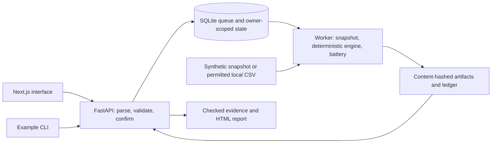

# Architecture

The release preserves the existing separation between API admission, queue execution, and checked presentation. SQLite and local files replace shared infrastructure for this single-machine demonstration.

| Directory | Responsibility |
|---|---|
| `apps/web` | Rule cards, data import, study lifecycle, evidence and reports |
| `services/api` | Principal scope, validation/confirmation, queue/store, evidence endpoints |
| `services/backtest-worker` | Backtest, validation batteries, immutable artifacts, report templates |
| `services/*-authority`, `services/control-plane-registrar` | Retained corrected-v3 components; no external authority is started or activated in this demo |
| `packages/strategy-schema` | JSON schemas, Python validation, TypeScript contracts |
| `data/synthetic` | Seeded fictitious OHLCV plus the content-addressed snapshot manifest |
| `tests` | Curated original assertions for execution, temporal rules, isolation and integrity |
| `scripts` | Local registration, process launcher, example and verification |

The web proxy routes API traffic to loopback. The worker has no public listener. Run state, CSV quarantine, sealed user snapshots, and logs are ignored under `var/`. Registration and checked read paths remain separate from numerical correctness: a valid hash does not prove a sound financial assumption.
