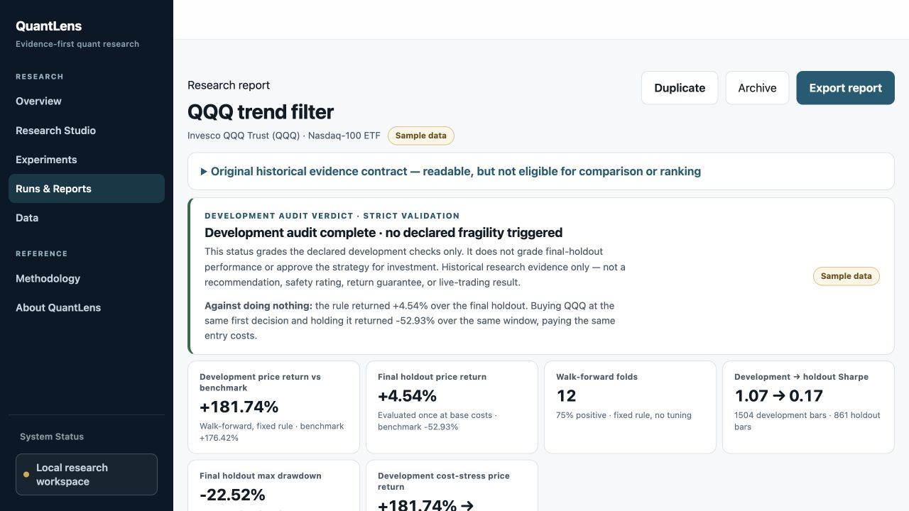

# Synthetic Battery v2 example

Generated by the real loopback API and separate worker on 2026-09-28 (Asia/Shanghai). This is fictitious data for software demonstration, not the historical performance of QQQ.

The rule is the QQQ-labelled price-vs-200-day-MA fixture, 2010-01-04 through 2020-12-31, with 2 bps commission and 3 bps slippage. The fixed-rule development plan produced 12 folds; final-holdout execution audit records one primary evaluation and zero counterfactual evaluations. Parameter sensitivity is NOT_RUN. The report retains the legacy evidence-contract warning and does not qualify for verified financial comparison/ranking.

`report.html` is the printable report; `evidence.json`, `manifest.json`, `ledger.json` and `artifacts/` allow inspection of the actual sealed study. `checks.json` records the report-byte and result hashes. Random run identities and timestamps are expected to differ in a new run; don't substitute this reference manifest for your own runtime.

```bash
python3.13 scripts/verify_example.py
```

This independent byte check verifies the 15 artifact files, the aggregate result/manifest binding, the HTML bytes and the included synthetic CSV hashes. It does not establish an external trust root or validate financial methodology. A fresh run through the application exercises the stricter registered presentation checks.


